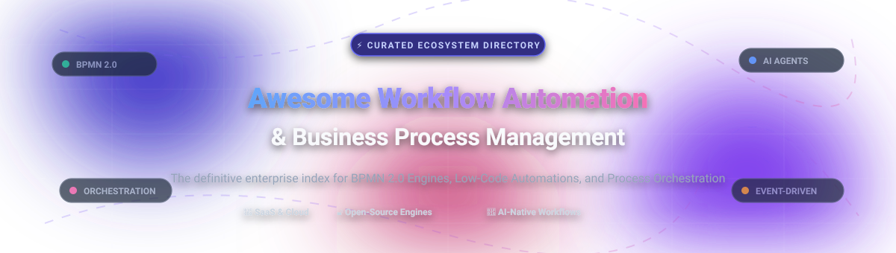

  

# ⚡ Awesome Workflow Automation & Business Process Management (BPM)

  
  
  
  
  
  

> 🌟 **A curated, battle-tested list of leading Workflow Automation and Business Process Management (BPM) platforms.** Explore top-tier cloud SaaS solutions, resilient open-source BPMN 2.0 engines, iPaaS connectors, and modern AI agent orchestrators designed for process modeling, automated execution, and enterprise digital transformation.

---

## 📑 Table of Contents

- [🌐 Sector Overview & Market Dynamics](#-sector-overview--market-dynamics)
- [☁️ SaaS & Hosted Commercial Platforms](#️-saas--hosted-commercial-platforms)
- [🔓 Open-Source Workflow & BPM Software](#-open-source-workflow--bpm-software)
- [📊 Feature Matrix & Comparison at a Glance](#-feature-matrix--comparison-at-a-glance)
- [📈 Star History](#-star-history)
- [🤝 Contributing](#-contributing)
- [☕ Support](#-support)
- [📄 License](#-license)

---

## 🌐 Sector Overview & Market Dynamics

The global **Workflow Automation and Business Process Management (BPM)** market is currently valued at approximately **$24B–$27B (2025–2026)** and is projected to surpass **$50B by 2030**, advancing at a robust compound annual growth rate (CAGR) of 10%–12%. 

Structurally, the market is **moderately fragmented**: enterprise platform giants (e.g., ServiceNow, Appian, Pegasystems, Microsoft Power Automate, and UiPath) hold high-value market share across mission-critical core architectures, while a dynamic, fast-expanding long-tail of innovative iPaaS startups, open-source orchestration engines, and AI-native automation platforms prevent a winner-take-all monopoly and provide diverse tooling options across the ecosystem.

---

## ☁️ SaaS & Hosted Commercial Platforms

A comprehensive comparison of leading hosted enterprise platforms, sorted in descending order by enterprise valuation and scale.

| Platform | Company Valuation / Revenue | Starting Price (Paid Tier) | Free Forever Tier Limit / Free Trial Limit | Core Architecture & Key Strength |
| :--- | :--- | :--- | :--- | :--- |
| **[Zoho Flow](https://www.zoho.com/flow/)** | **~$12.5B Valuation** (~$1.5B Revenue) | **$25/month** (Standard plan billed annually, or $29/mo monthly) | **Free Forever:** 5 active flows, 100 tasks/month, 15-minute polling interval | Cloud-native no-code integration platform deeply embedded in the Zoho suite with Zia AI natural language automation. |
| **[Workato](https://www.workato.com/)** | **~$5.7B Valuation** (~$150M ARR) | **$75/month** (Base self-service Pro; Enterprise plans custom quoted) | **Free Plan:** One-time 50,000 non-renewing credits for prototyping and testing | Enterprise-grade iPaaS with 1,000+ connectors, reusable recipes, governance controls, and AI agent execution. |
| **[Zapier](https://www.zapier.com/)** | **~$5.0B Valuation** (~$310M+ ARR) | **$19.99/month** (Professional tier billed annually, or $29.99/mo monthly) | **Free Forever:** 100 tasks/month, 2-step Zaps only (1 trigger, 1 action), 15-min check interval | World's largest third-party connector ecosystem connecting 7,000+ cloud applications with trigger-action pipelines. |
| **[Appian](https://appian.com/)** | **~$3.6B Market Cap** (~$600M Revenue) | **$75/user/month** (Standard commercial tier; enterprise custom quote) | **Free Forever:** Appian Community Edition (personal dedicated environment for prototyping & training) | Enterprise low-code process orchestration suite with complete BPMN standards, data fabric, and compliance auditing. |
| **[Nintex](https://www.nintex.com/)** | **~$2.0B Valuation** (~$250M ARR) | **~$25,000/year** (Enterprise platform packages; direct vendor quote) | **30-Day Free Trial:** Full platform access to Nintex Workflow, forms, and Process Manager (no credit card) | Enterprise workflow automation, document generation, and process mapping with deep SharePoint and cloud integrations. |
| **[Camunda 8](https://camunda.com/)** | **~$1.0B+ Valuation** (~$150M–$200M ARR) | **$49/month** (Professional Starter tier; Enterprise custom consumption quotes) | **Free Forever:** Web Modeler (BPMN/DMN modeling with 5 seats) + **30-Day Free Trial** for cloud process execution | High-throughput distributed microservice orchestration engine (Zeebe) with external workers and BPMN 2.0 standards. |
| **[Make](https://www.make.com/)** | **Subsidiary of Celonis** ($13B Parent Valuation; ~$60M ARR) | **$9/month** (Core plan billed annually, or $10.59/mo monthly) | **Free Forever:** 1,000 credits/month, 2 active scenarios, 5 MB file size limit, 15-min interval | Visual drag-and-drop workflow canvas supporting complex branching logic, arrays, and detailed data manipulation. |
| **[Kissflow](https://kissflow.com/)** | **~$250M Valuation** (~$40M–$50M ARR) | **$1,500/month** (Basic tier starting bundle; Enterprise custom quote) | **14-Day Free Trial:** Guided evaluation and sandbox access provisioned following product demo | Human-centric no-code digital workplace for approval chains, procurement routing, and internal business apps. |
| **[Pipefy](https://www.pipefy.com/)** | **~$150M Valuation** (~$70M ARR) | **$20/user/month** (Business tier billed annually, or $26/mo monthly) | **Free Forever (Starter):** Up to 10 users, 5 active pipes (processes), 15 automations, 20 API calls | Kanban-style visual process management platform optimized for customer onboarding, HR service desks, and procurement. |
| **[ProcessMaker](https://www.processmaker.com/)** | **~$100M Valuation** (~$35M ARR) | **$1,495/month** (Standard package; scale-up consumption tiers available) | **Free Trial:** Custom 14-to-30 day Proof-of-Concept environment provided upon demo request | Low-code BPM platform offering visual diagramming, form designers, and SLA compliance monitoring. |

---

## 🔓 Open-Source Workflow & BPM Software

Self-hosted, transparent, and community-driven Workflow Automation engines and BPMN platforms. All repositories are sorted in descending order by GitHub stargazers.

| Project & Repository | Stars_Count | License | Stack | Architecture & Key Capabilities |
| :--- | :--- | :--- | :--- | :--- |
| **[n8n](https://github.com/n8n-io/n8n)** |  | Sustainable Core (Fair-Code) | TypeScript / Node.js | Visual node-based workflow builder with 400+ native integrations, custom JavaScript/Python execution nodes, advanced AI agent blocks, and self-hosted privacy. |
| **[Huginn](https://github.com/huginn/huginn)** |  | MIT | Ruby | A hackable open-source system for building automated agents that scan websites, parse data, trigger webhooks, and perform automated actions on your behalf. |
| **[Kestra](https://github.com/kestra-io/kestra)** |  | Apache 2.0 | Java / Vue | Infinitely scalable, declarative YAML-driven workflow orchestrator for data pipelines, business operations, microservices, and AI workflows. |
| **[Activepieces](https://github.com/activepieces/activepieces)** |  | MIT / Fair-Code | TypeScript / Node.js | Modern, self-hostable Zapier alternative equipped with an extensive library of open-source "pieces", native MCP server protocols, and AI agent connectors. |
| **[Temporal](https://github.com/temporalio/temporal)** |  | MIT | Go | Durable execution platform ensuring that stateful code and business workflows run to completion despite network partitions, hardware failures, and long delays. |
| **[Node-RED](https://github.com/node-red/node-red)** |  | Apache 2.0 | JavaScript / Node.js | Low-code event-driven programming platform for wiring together hardware devices, APIs, webhooks, and enterprise online services via a browser-based canvas. |
| **[Automatisch](https://github.com/automatisch/automatisch)** |  | AGPL-3.0 | JavaScript / React | Private, self-hosted workflow automation tool built as an open Zapier alternative with strict GDPR compliance and zero cloud data leaks. |
| **[Activiti](https://github.com/Activiti/Activiti)** |  | Apache 2.0 | Java | Battle-tested, lightweight BPMN 2.0 process engine designed for high-performance Java applications, microservice architectures, and Spring Cloud environments. |
| **[Flowable](https://github.com/flowable/flowable-engine)** |  | Apache 2.0 | Java / Spring Boot | High-performance enterprise workflow engine natively implementing BPMN 2.0 (processes), CMMN 1.1 (cases), and DMN 1.2 (business rules) with embeddable runtime engines. |
| **[SpiffWorkflow](https://github.com/sartography/SpiffWorkflow)** |  | LGPL-3.0 | Python | Pure Python workflow engine supporting BPMN 2.0 and DMN specifications with Python scripts, JSON task schemas, and web diagramming integrations. |
| **[Apache jBPM](https://github.com/kiegroup/jbpm)** |  | Apache 2.0 | Java / KIE | Red Hat-backed enterprise business automation suite integrating BPMN process management with Drools business rules engines and Complex Event Processing (CEP). |
| **[Operaton](https://github.com/operaton/operaton)** |  | Apache 2.0 | Java | Community-governed open-source fork of Camunda 7 featuring Cockpit, Tasklist, Admin webapps, Keycloak integration, and Model Context Protocol (MCP) servers. |
| **[Bonita Engine](https://github.com/bonitasoft/bonita-engine)** |  | LGPL-2.1 | Java | Comprehensive digital process automation runtime providing process execution, user portal forms, document attachments, and application page design. |
| **[CIB seven](https://github.com/cibseven/cibseven)** |  | Apache 2.0 | Java | Full drop-in open-source replacement for Camunda 7 offering continuous enterprise-ready updates, security patches, Docker images, and Helm charts. |

---

## 📊 Feature Matrix & Comparison at a Glance

| Tool / Platform | Category | Primary Tech Stack | BPMN 2.0 Compliant | Human Task Management | Self-Hosted Option | Best Target Use Case |
| :--- | :--- | :--- | :---: | :---: | :---: | :--- |
| **Zoho Flow** | SaaS / iPaaS | Cloud | ❌ | ❌ | ❌ | Teams embedded in the Zoho ecosystem wanting no-code integration |
| **Workato** | Enterprise iPaaS | Cloud | ❌ | Limited | ❌ | Enterprise-grade cross-application workflow recipes and governance |
| **Zapier** | SaaS iPaaS | Cloud | ❌ | ❌ | ❌ | Universal app-to-app triggers across 7,000+ third-party tools |
| **Appian** | Low-Code BPM | Cloud / Java | ✅ | ✅ | Limited | Highly regulated corporate operations requiring complete auditing & case management |
| **Nintex** | Enterprise Automation | Cloud / .NET | ❌ | ✅ | ✅ | Microsoft SharePoint workflows, automated forms, and document workflows |
| **Camunda 8** | Process Orchestration | Cloud / Zeebe / Java | ✅ | ✅ | ✅ (Non-prod) | High-throughput distributed microservice orchestration |
| **Make** | Visual iPaaS | Cloud | ❌ | ❌ | ❌ | Complex visual pipelines with nested JSON data manipulations |
| **Kissflow** | Digital Workplace | Cloud | ❌ | ✅ | ❌ | Non-technical business department workflow requests and internal forms |
| **Pipefy** | Process Kanban | Cloud | ❌ | ✅ | ❌ | Operations teams tracking approval tickets, hiring, and procurement |
| **ProcessMaker** | Low-Code BPM | Cloud / PHP / Docker | ✅ | ✅ | ✅ | Streamlined form-driven business process automation |
| **n8n** | Open-Source Automation | TypeScript / Node.js | ❌ | ✅ | ✅ | Self-hosted integration workflows, webhooks, and AI agent loops |
| **Huginn** | Open-Source Agent | Ruby | ❌ | ❌ | ✅ | Personal web scraping, alert dispatching, and automated online tasks |
| **Kestra** | Declarative Orchestration | Java / YAML | ❌ | ✅ | ✅ | Enterprise data pipelines, DevOps automation, and multi-cloud scripts |
| **Activepieces** | Open-Source Automation | TypeScript / Node.js | ❌ | ❌ | ✅ | Privacy-first open Zapier alternative with modern AI/MCP connectors |
| **Temporal** | Durable Orchestration | Go | ❌ | ❌ | ✅ | Mission-critical code-as-workflow execution and distributed transactions |
| **Node-RED** | Visual Flow Builder | JavaScript / Node.js | ❌ | ❌ | ✅ | IoT device control, MQTT event handling, and quick API webhooks |
| **Automatisch** | Open-Source Automation | JavaScript / Node.js | ❌ | ❌ | ✅ | Privacy-focused trigger/action automations without third-party vendor tracking |
| **Activiti** | Open-Source BPMN | Java / Spring Boot | ✅ | ✅ | ✅ | Embeddable BPMN workflows within custom Java enterprise microservices |
| **Flowable** | Open-Source BPMN | Java / Spring Boot | ✅ | ✅ | ✅ | Unified BPMN processes, CMMN cases, and DMN decision engines |
| **SpiffWorkflow** | Open-Source BPMN | Python | ✅ | ✅ | ✅ | Python-native data science and backend workflows using standard BPMN 2.0 |
| **Apache jBPM** | Open-Source BPM | Java / KIE | ✅ | ✅ | ✅ | Red Hat ecosystem workflows with Drools business rule engines |
| **Operaton** | Open-Source BPMN | Java | ✅ | ✅ | ✅ | Community-governed Camunda 7 alternative with zero vendor licensing fees |
| **Bonita** | Open-Source BPM | Java | ✅ | ✅ | ✅ | End-to-end business applications combining process runtime and UI portal |
| **CIB seven** | Open-Source BPMN | Java | ✅ | ✅ | ✅ | Direct 1:1 drop-in replacement for existing Camunda 7 production clusters |

---

## 📈 Star History

---

## 🤝 Contributing

Contributions, additions, and updates are warmly welcomed! Please help maintain this list as the premier workflow automation reference:

1. 🍴 Fork the repository.
2. 🌿 Create a descriptive branch (`git checkout -b feature/add-new-platform`).
3. 📝 Add your recommended platform under the respective category in alphabetical or categorized order.
4. 🚀 Ensure the tool is actively maintained with valid links, licenses, and clear descriptions.
5. 📬 Submit a Pull Request with a short explanation of why the tool adds value to the community.

Explore more curated lists across the developer ecosystem at **[Awesome-Awesome-Awesome](https://github.com/ishandutta2007/Awesome-Awesome-Awesome)**.

---

## ☕ Support

If you found this curated list helpful, please consider showing your support:
- ⭐ **Star this repository** to help others discover it on GitHub.
- 🍴 **Fork it** to bookmark and customize it for your team.
- 📢 **Share it** with fellow software architects, DevOps engineers, and automation enthusiasts.
- 💖 **Sponsor the Maintainer:** Consider buying a coffee or providing financial sponsorship via the [GitHub Sponsors Dashboard](https://github.com/sponsors/ishandutta2007).

---

## 📄 License

This repository is licensed under the [Creative Commons Zero v1.0 Universal (CC0 1.0)](https://creativecommons.org/publicdomain/zero/1.0/) public domain dedication. Listed products, services, trademarks, and source codes belong to their respective creators and owners.
